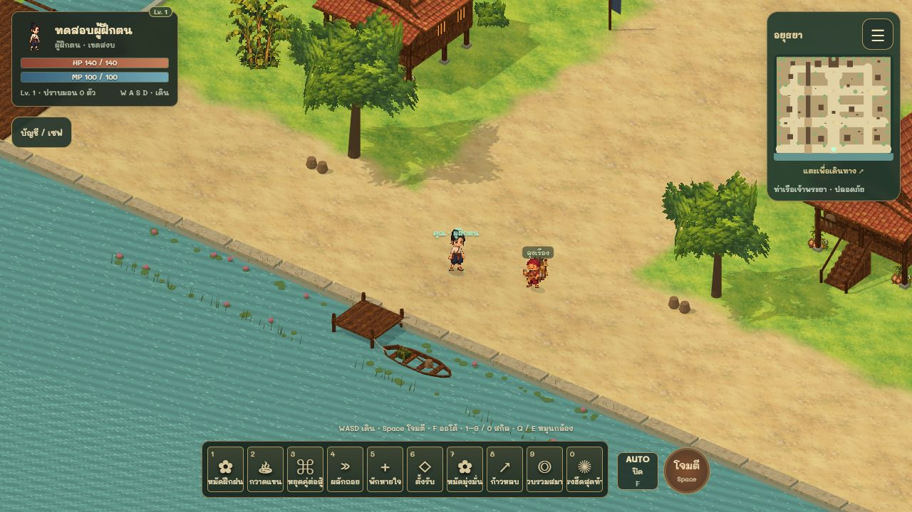

# Ayothaya Folk Mystic

เกมแฟนตาซีไทยแบบ Chibi Pixel 2.5D หมุนกล้องได้ เริ่มโลกใหม่จาก **อยุธยา เมืองหลวงแห่งสายน้ำและประทีป**

**[เปิดเล่นออนไลน์](https://ayothaya-folk-mystic.vercel.app/)** · **[ภาพเมืองหลวง](https://ayothaya-folk-mystic.vercel.app/world-gallery.html)**

## ตัวละครและการเติบโต (0.18)

- 5 ช่องรวมต่อบัญชี แยกเซฟ ตำแหน่ง รูปลักษณ์ และความคืบหน้าของแต่ละตัว รองรับทั้ง Google/Firestore และโหมดทดลองบนเครื่อง
- ผู้ฝึกตนชาย/หญิงมีภาพและท่าพื้นฐาน 4 เฟรมใน `assets/classes/novice-18.png`; สร้างด้วย built-in image_gen และบันทึกพรอมป์ใน `assets/classes/novice-prompts-18.json` ยังไม่ใช่แอนิเมชันหลายทิศสมบูรณ์
- Lv. 25 เลือกหนึ่งใน 7 อาชีพ; Lv. 60 เลือก Master จากสองสายของอาชีพนั้น ปัจจุบันเลเวลยังคำนวณจากจำนวนมอนสเตอร์: `1 + floor(kills / 10)` สูงสุด 99 (240 / 590 ตัวตามลำดับ) ยังไม่ใช่ระบบ XP จากเควสต์
- กฎ Firestore จำกัดเจ้าของและช่อง 1–5 ตรวจเงื่อนไขเปลี่ยนอาชีพจากเซฟก่อนหน้า พร้อม revision ป้องกันเซฟเก่าทับใหม่ ระบบยังคำนวณผลการเล่นฝั่ง client
- ตรวจแล้ว: 86 automated tests, production build, guest สร้าง→เข้าเกม→กลับมาโหลดตัวเดิม, จอแนวนอน 844×390 และ 568×320; Rules Playground ตรวจเจ้าของ/คนอื่น/ไม่มีบัญชี/ช่อง 6 ยังไม่ได้ยืนยัน Google save/load ข้ามเครื่องด้วยบัญชีจริงในรอบนี้

## เมืองหลวงใหม่ (0.19)

แมพทั้ง 12 แห่งเดิมถูกถอดออกจากชุดเผยแพร่ เหลืออยุธยาใหม่หนึ่งเมือง ขนาดพื้นที่เดินหลัก 126 × 114.4 หน่วย มี 8 ย่าน ทางหลักกว้าง 11–13 หน่วย และคลองพร้อมสะพาน 3 แห่ง ทุกย่านเดินถึงกันได้ ไม่มีมอนสเตอร์หรือประตูไปแมพเก่า

ฉากใช้เรือนไทย 3D พื้นหญ้าและดินผสมขอบนุ่มใน world space พุ่มใบไม้โปร่งแบบ instancing เงาอาคาร/ต้นไม้ แสงกลางวัน น้ำไหล เรือโยก และใบไม้ร่วง กล้องยังหมุนได้ ตัวละครยังเป็น Chibi pixel และใช้ชุดท่าเดิม รุ่นนี้ปรับฉาก ไม่ได้สร้างแอนิเมชันตัวละครใหม่

Asset พื้นผิว: `assets/capital-materials19.png`; ใบไม้: `assets/capital-leaves19.png`; พรอมป์ built-in image_gen: `assets/capital19-prompts.json` และ `assets/capital19-foliage-prompt.json` แผนที่และชนกำแพงสร้างร่วมกันด้วย `build_capital19.py` ใช้ Blender 5.2 ส่วนวัสดุและพุ่มใบไม้ประกอบที่ runtime ใน `capital-look.js`

NPC หลัก 6 คนมีบทสนทนาแนะนำเรื่องสายใยขวัญ ยังไม่มีระบบเควสต์ใช้งานจริง เนื้อหาเมืองอื่นใน `content/chapter-01.json` เปลี่ยนเป็นแผนงานอนาคต

เซฟที่มี ID แมพเก่าทั้ง 11 แห่งยังอ่านได้ โดยย้ายเข้าเมืองหลวงตอนเล่นและเก็บทรัพยากร/เลเวล/รูปลักษณ์ไว้ พิกัดเดิมไม่ถูกใช้ข้ามแมพ; เซฟอยุธยาเดิมใช้ตำแหน่งเฉพาะถ้ายังเดินได้ในผังใหม่ เซฟครั้งถัดไปบันทึกเมืองใหม่ตามปกติ ไม่เปลี่ยน Firestore rules

ไฟล์แมพเก่ากู้ได้จาก Git ก่อนรุ่นนี้ ตัวสร้าง `build_world05.py`/`build_regions12.py` เป็นส่วนประกอบและประวัติงาน อย่ารันเพื่อเผยแพร่ทับเมืองใหม่

## ควบคุม

- คอม: WASD เดิน, Space โจมตี, F ออโต้, 1–9 และ 0 สกิล, Q/E หมุนกล้อง
- M แผนที่โลก, R คุย/เดินทางเมื่ออยู่ใกล้, V ดูทั้งเมือง
- มือถือ: **เล่นแนวนอนเท่านั้น** จอยซ้ายเดิน ปุ่มขวาโจมตี/สกิล ลากฉากฝั่งขวาหมุนกล้องและสองนิ้วซูม
- แนวตั้งแสดงหน้าขอให้หมุนเครื่องและพักเกม ปุ่มเต็มจอพยายามล็อกแนวนอนเมื่อเบราว์เซอร์รองรับ เบราว์เซอร์ที่ไม่รองรับต้องหมุนเครื่องเอง

เว็บเปิดเล่นได้ผ่านอินเทอร์เน็ต เกมรุ่นนี้เป็น **single-player prototype** พร้อม Google Login และเซฟผ่าน Firebase ไม่มีเซิร์ฟเวอร์ผู้เล่นร่วมโลกเดียวกัน

## หน้าเข้าเกม

หน้าแรกเป็นล็อบบีแยกจากฉากเกม: **Google Login / ทดลองเล่น → เซิร์ฟ 1 หรือ 2 → สร้างหรือเลือกตัวละคร → เข้าเกม** แต่ละบัญชีมีรวม **5 ตัวละครข้ามทั้งสองเซิร์ฟเวอร์** แต่ละตัวผูกกับเซิร์ฟเวอร์ที่สร้าง ตั้งชื่อ 2–16 ตัวและเลือกรูปลักษณ์ชาย/หญิงได้ ตัวใหม่เริ่มเป็น **ผู้ฝึกตน (Novice) Lv. 1** เมื่อ Lv. 25 เลือกได้ 7 อาชีพ: นักดาบ นักทวน นายพราน นักมวย จอมโจร หมอผี และพระ/แม่ชี แต่ละอาชีพมีรูปลักษณ์ชาย/หญิง ท่าและสกิลต่างกัน

ภาพหน้าเข้าเกมเป็น Ayutthaya Pixel Folk Mystic พร้อมโมชั่นละอองแสงและตัวละคร ปิดโมชั่นได้และเคารพ prefers-reduced-motion ตัวเกมโหลด 3D หลังเลือกตัวละครแล้วเท่านั้น `index.html` / `lobby.js` คือหน้าเข้าเกม และ `game.html` คือฉากเล่น

เซิร์ฟ 1/2 เป็นพื้นที่แยกตัวละครและเซฟ ยังไม่ใช่เซิร์ฟเวอร์มัลติเพลเยอร์ ตัวละครเดิมของเซิร์ฟ 1/2 ถูกคัดลอกไปช่อง 1/2 ตามลำดับ โดยเก็บชื่อ รูปลักษณ์ อาชีพ ความคืบหน้า และต้นฉบับไว้

## อาชีพและแอนิเมชัน (0.9)

- ตั้งแต่ 0.18: เลือกอาชีพครั้งเดียวเมื่อ Lv. 25 และเลือกสาย Master ครั้งเดียวเมื่อ Lv. 60 ผ่านหน้าเลือกตัวละคร/แต่งตัว ตัวละครเก่าคงอาชีพและ Master เดิมไว้ แม้ยังไม่ถึงเกณฑ์ใหม่
- สไปรต์ 14 รูปลักษณ์: แต่ละรูปมีท่ายืน เดินสองจังหวะ และโจมตี/ร่าย ใช้ atlas 4 คอลัมน์ × 2 แถว (ชายบน หญิงล่าง) เป็นแอนิเมชันพื้นฐาน ไม่ใช่ชุดแปดทิศหรือคอมโบหลายเฟรมสมบูรณ์
- ชุดสกิลต้นแบบ 10 ช่องต่ออาชีพ: ระยะ ความเร็ว การโจมตี เอฟเฟกต์ และการฟื้นฟูต่างกัน แต่บางสกิลใช้กลไกพื้นฐานร่วมกัน ยังไม่ผ่านบาลานซ์สำหรับ multiplayer
- NPC หายใจ/โยกตัว; มอนสเตอร์มี idle, เดินโยก, พุ่งโจมตีและสะดุ้ง; UI เปลี่ยนขั้นตอนและสถานะอย่างนุ่มนวล รองรับ reduced-motion
- ไฟล์ภาพใหม่ใน `assets/classes/` สร้างด้วย built-in ImageGen; prompt ครบชุดอยู่ใน `assets/classes-prompts-09.json` ต้นฉบับเก่ายังคงอยู่
- แก้ข้อมูลอาชีพที่ `classes.js` และจังหวะท่าที่ `sprite-motion.js`

## บัญชีและเซฟ

กด **เข้าสู่ระบบด้วย Google** ที่หน้าแรก แล้วเลือกเซิร์ฟและตัวละคร เพื่อเล่นต่อข้ามเครื่อง เซฟ HP/MP จำนวนมอนที่ปราบ คูลดาวน์ เมือง ตำแหน่ง ซูม มุมกล้อง และสถานะโมชั่น ทุก 10 วินาทีเมื่อมีข้อมูลเปลี่ยน ก่อนเปลี่ยนเมือง และก่อนออกจากระบบ มีปุ่มเซฟทันที และพยายามเซฟเมื่อสลับแท็บ การปิดแอปทันทีอาจทำให้ข้อมูลหลังเซฟครั้งล่าสุดยังไม่ส่งถึงคลาวด์

โหมดเล่นบนเครื่องนี้เก็บใน localStorage แยกจากบัญชี Google ไม่ย้ายหรือเขียนทับตัวละครคลาวด์อัตโนมัติ กระเป๋า อุปกรณ์ เงิน และเควสต์ยังไม่ถูกสร้าง จึงยังไม่มีข้อมูลเหล่านั้นให้บันทึก

Firebase project: `ayothaya-folk-mystic`, Firestore Standard `(default)` ที่ `asia-southeast3` (Bangkok), Spark plan. เซฟอยู่ที่ `players/{uid}/characters/slot-1` ถึง `slot-5`; `saves/server-1`, `server-2` และ `main` เก็บข้อมูลเก่าไว้; กฎอนุญาตเฉพาะเจ้าของและตรวจรูปแบบข้อมูล ใช้ transaction/revision ป้องกันแท็บเก่าทับเซฟใหม่ เมื่อเกิดข้อขัดแย้งต้องโหลดเซฟล่าสุดก่อนเล่นต่อ

นี่เป็นระบบเซฟต้นแบบฝั่ง client; กฎป้องกันการแก้เซฟคนอื่น แต่ยังไม่ตรวจผลการต่อสู้บนเซิร์ฟเวอร์ ก่อนเพิ่มการซื้อขาย อันดับ หรือเงินจริง ต้องย้ายการคำนวณรางวัลไปเซิร์ฟเวอร์

## รันในเครื่อง

ใช้ Python 3: `python -m http.server 8767` แล้วเปิด `http://localhost:8767/`

ทดสอบด้วย Node.js: `npm test` (ไม่ต้องติดตั้งแพ็กเกจ)

ไลบรารี Three.js อยู่ใน `vendor/` พร้อมไฟล์ลิขสิทธิ์ Firebase SDK 13 โหลดจาก CDN ของ Google ค่าใน `firebase-config.js` เป็น public web configuration; ห้ามใส่ service account หรือ admin credential ในหน้าเว็บ

## แก้แมพและภาพ

`maps/world.json` คือข้อมูลฉากและเส้นทาง `maps/*.blend` และ `maps/*.glb` คือโครงสร้างเมืองหลวงใหม่ สร้างด้วย Blender: `blender --background --python build_capital19.py`

Blender เก็บ geometry/UV; ตัวละคร พืช พื้นผิว แสง และโมชั่นประกอบใน `viewer-world.js` กับ `ambient-motion.js` ภาพ PNG และพรอมป์จาก built-in ImageGen อยู่ใน `assets/`

ล็อบบีและเซิร์ฟ: `lobby.js`, `realm-state.js`, `realm-store.js`; ส่วนเกม: `combat-core.js`, `game-controls.js`; การเดินทาง: `world-ui.js`, `world-state.js`; แนวนอนมือถือ: `mobile-layout.js`, `mobile-layout.css`

## ตรวจสอบ

65 automated tests ครอบคลุมการเดิน การชน ทางอ้อม ต่อสู้ จุดเกิดทุกเมือง ข้ามเมือง กฎแนวนอน การคืนค่าเซฟ และ revision conflict; ยังไม่ได้ยืนยัน hardware orientation lock หรือ multitouch ด้วยมือถือจริง

## เผยแพร่

Vercel เชื่อม repository นี้กับ branch `main` และเผยแพร่ที่ https://ayothaya-folk-mystic.vercel.app/ อัตโนมัติเมื่อ push ใช้ `npm run build` เพื่อคัดลอกไฟล์เล่นเกมไป `dist/` โดยไม่ส่งไฟล์ Blender ต้นฉบับ ชุดทดสอบ หรือกฎ Firestore ขึ้นเว็บ การตั้งค่าอยู่ใน `vercel.json`

โดเมน Vercel เพิ่มใน Firebase Authentication Authorized domains แล้ว ใช้ Firebase project เดิม บัญชี Google เดิมจึงอ้างอิงข้อมูลคลาวด์ชุดเดิม ส่วนเซฟทดลองใน localStorage แยกตามโดเมนและไม่ย้ายจาก GitHub Pages อัตโนมัติ การทดสอบล็อกอิน Google และเซฟคลาวด์ด้วยบัญชีจริงยังต้องยืนยันเพิ่มเติม

GitHub Pages ใช้ branch `main` ที่ root โฟลเดอร์นี้มี `.nojekyll` และใช้เส้นทาง relative เพื่อรองรับชื่อ repository ใน URL ผลัก commit ใหม่เพื่ออัปเดตเว็บ

ภาพล็อบบีและตัวละครชาย/หญิงสร้างด้วย built-in ImageGen เก็บใน `assets/login-ayutthaya.png` และ `assets/shaman-genders.png` พรอมป์อยู่ใน `assets/lobby-prompts.json`

## Detail and mobile HUD update (0.13)
- Added district benches, lanterns, herb beds, handcarts, merchandise, laundry, temple offerings and garden pools; wilderness rock clearings and rest stops. Collision remains authored with scenery.
- Top-right minimap opens travel; camera controls moved to a modal menu. Town target banner hidden.
- Mobile: five visible skill buttons per bank, all ten available through a 44px switch; 44px+ main controls, safe-area positioning and compact status panel. Desktop retains all ten skills.
- Local regression: 59 tests pass, static production build passes. Responsive browser checks at 844x390 and 568x320; physical-device FPS and multitouch not measured.

## Character customization and progression (0.14)
- Appearance and advanced profession persist per UID and server alongside existing game state; legacy characters remain compatible. Active-account checks prevent a stale session from saving to another account. Autosave every 10 seconds when dirty.
- Wardrobe supports garment overlays, outfit/hair/eye palettes, hair additions, facial hair and yantra marks. Preview and in-game atlas share the same compositor. Original baked-in hair/facial hair is retained; monastic classes retain shaved heads.
- Ten motion states reuse the existing four illustrated frames with class-sensitive transforms. Four emotes are available in the game menu. These are not ten newly drawn sprite animations.
- Each of seven base classes has two advanced branches with combat stat/skill modifiers. Unlock at level 10 (90 total defeats); prototype XP = defeats x 10. No advancement quest or separate advanced-class sprite atlas yet.
- Wardrobe has touch-sized controls and internal scrolling. Closing without applying discards the draft. Existing character edits use revision-checked saves.
- Validation: 65 automated tests; production build; local save/reload, appearance in game, emote and mobile wardrobe/cancel checks. Live authenticated cloud roundtrip still requires verification.

## Character motion (0.15)
- Replaced full-image bounce/stretch with a softly weighted mesh: alternating legs, opposite arm swing, torso/head counter-motion and grounded idle soles. Gait advances from actual traveled distance, stops against obstacles and ignores teleport jumps.
- Attack timing has one anticipation/strike/recovery sequence per event, with profession-specific duration. Hit reactions now trigger correctly, with an independent hit timer. Monk, rogue, boxer and staff-user gait amplitudes differ.
- Same deformation model in lobby/wardrobe Canvas previews and the camera-facing Three.js world mesh. Preview renders at 30 FPS and pauses when hidden or covered; no extra WebGL context. Reduced motion remains static.
- Uses existing front-facing artwork. Does not add rear-facing or eight-direction sprites, independently drawn limb frames, true skeletal joints, or exact foot locking. NPC and monster art remains unchanged.
- 69 tests passed; final focused motion tests passed after class gait tuning. Browser checked local wardrobe walk, game render, emote and mobile844x390 joystick movement without console errors. Physical mobile frame rate unmeasured.

## แผนพัฒนาเกมเต็ม — Phase 1

จัดทำแบบบทแรก “ประทีปที่ดับพร้อมกัน” แล้ว: เควสต์ 10 ตอน, NPC หลัก 6 คน, มอน 4 ชนิดและบอสใหม่ 1 ตัว พร้อมแผน EXP/เงิน ข้อมูลนี้ยังไม่ถูกโหลดเป็นเควสต์ในเกมจริง

- [แบบเกมและเนื้อเรื่อง](docs/GAME-DESIGN.md)
- [ข้อกำหนดสไปรต์และ Asset](docs/ASSET-SPEC.md)
- [รายการงาน Phase 2–10 และเกณฑ์ตรวจรับ](docs/PRODUCTION-PLAN.md)
- [ข้อมูลบทแรก](content/chapter-01.json) — ตรวจด้วย `npm run check:content`

## ห้องลองหมอผีหลายทิศ (0.16 / Phase 2 A01)

[เปิดห้องลองตัวละคร](https://ayothaya-folk-mystic.vercel.app/sprite-lab.html) — ชาย/หญิง 8 ทิศ หมุนกล้องและตรวจฐานเท้าได้ ไม่ต้องล็อกอิน

ในเกม อาชีพหมอผีเปิดเมนูกล้อง → “ลองหมอผี 8 ทิศ · ชุดมาตรฐาน” เพื่อใช้ภาพต้นแบบกับการเดินจริง ปิดตัวเลือกเพื่อคืนชุดและภาพเดิม โหลดภาพเฉพาะเมื่อเปิดใช้และไม่แก้ข้อมูลเซฟ รูปใหม่ยังเป็นท่ายืน ใช้การขยับแบบเดิมชั่วคราว คลิปเดิน/โจมตีจริงและการแยกชั้นเครื่องแต่งกายเป็นงาน A02–A04 ต่อไป

Source: `assets/directional/shaman-{front,rear,left}-16.png`; crop/foot anchors: `shaman-16.json`; prompt ทั้งชุดและเครื่องมือ built-in image_gen: `prompts-16.json` ภาพสร้างยังต้องเก็บความต่อเนื่องของคทาและเครื่องประดับก่อนนำไปผลิตคลิปเต็ม

## ทุกอาชีพหลายทิศ (0.17 / Phase 2 A01 extension)

- ขยายชุดท่ายืนเป็น 7 อาชีพ × ชาย/หญิง × 8 ทิศ = 112 ภาพ: นักดาบ นักทวน นายพราน นักมวย จอมโจร หมอผี และพระ/แม่ชี
- ห้องลองมีตัวเลือกอาชีพและลิงก์ `sprite-lab.html?class=boxer` สลับภาพโดยไม่โหลดหน้าใหม่ พร้อมคืน GPU textures เก่าและกันผลโหลดอาชีพเก่าทับตัวเลือกใหม่
- เมนูกล้องในเกมเปิดภาพ 8 ทิศได้ทุกอาชีพ โหลดเฉพาะอาชีพที่เล่นเมื่อเปิดตัวเลือก; ปิดเพื่อคืนชุดเดิม ไม่แก้ข้อมูล appearance
- PNG ต้นฉบับและ crop/foot metadata อยู่ใน `assets/directional/`; พรอมป์สร้างและแก้ภาพด้วย built-in image_gen อยู่ใน `prompts-17.json` นักทวนมีภาพแก้ด้านหลังแยกต่างหาก
- เป็น neutral turnaround และชุดมาตรฐาน ใช้ mesh deformation เดิมชั่วคราว ยังไม่มีคลิปเดิน/โจมตีวาดแยกหรือเสื้อผ้าหลายชั้น ความต่อเนื่องของมือ อาวุธและเครื่องประดับยังต้องเก็บก่อนทำคลิปจริง
- ตรวจรับ: 80 automated tests ผ่าน, content validator และ production build ผ่าน; สลับครบ 7 อาชีพในเบราว์เซอร์ ไม่มี console errors; หน้าแม่ชีด้านหลังแสดงถูกต้อง และจอ 844×390 / 568×320 ไม่ล้น document ยังไม่ได้วัด FPS บนมือถือจริง

## UI และธรรมชาติ (0.20)

HUD ใช้กรอบไม้สัก ทองเก่า และหยกจาก `assets/ui-kit20.png` (built-in ImageGen; พรอมป์ `assets/ui20-prompts.json`) แยกช่องภาพด้วย canvas ตอนเริ่มเกมใน `art-hud.js` และวางข้อความ/ข้อมูลจริงด้วย HTML/CSS ใน `art-hud.css` ตัวเลข HP/MP สกิล และแผนที่ยังอัปเดตตามเกม มี fallback หากโหลดภาพไม่ได้ ไม่ได้เพิ่มระบบเควสต์หรือแชตจากภาพ mockup

มือถือแนวนอนใช้สกิล 5 ช่องสลับหน้า จอยซ้าย ปุ่มโจมตี 68px และแผนที่ย่อ ส่วนคอมแสดง 10 ช่อง พร้อมคู่มือเปิดเส้นทางเมืองและปุ่มย่อคู่มือ ใช้ safe-area และปุ่มสกิลอย่างน้อย 44px บนจอ 568×320

พุ่มไม้มีแกนพุ่ม 3D รูปทรงไม่สม่ำเสมอและใบโปร่งรอบนอก กิ่ง/รากแบบ instancing พื้นผิวลำต้น และโอ่งดินเผาปากเปิด มีดอกไม้ข้างพุ่ม กล้องหมุนได้รอบ ตำแหน่งชนเดิมยังใช้ตามแมพ รุ่นนี้ยังเป็นงานภาพ 3D stylized ไม่ใช่ภาพ mockup วาดมือแบบหนึ่งต่อหนึ่ง

ตรวจ 62 tests, content validation และ production build ผ่าน ลองบนเบราว์เซอร์: 1280×720, 844×390, 568×320, แนวตั้ง 390×844; สลับสกิล, ใช้เกราะแล้ว MP ลด, จอยเดิน, แผนที่เดินทาง, เมนูกล้อง/หมุน และโหลดเซฟเดิม ไม่มี console error ยังไม่ได้วัด FPS บนมือถือจริง
