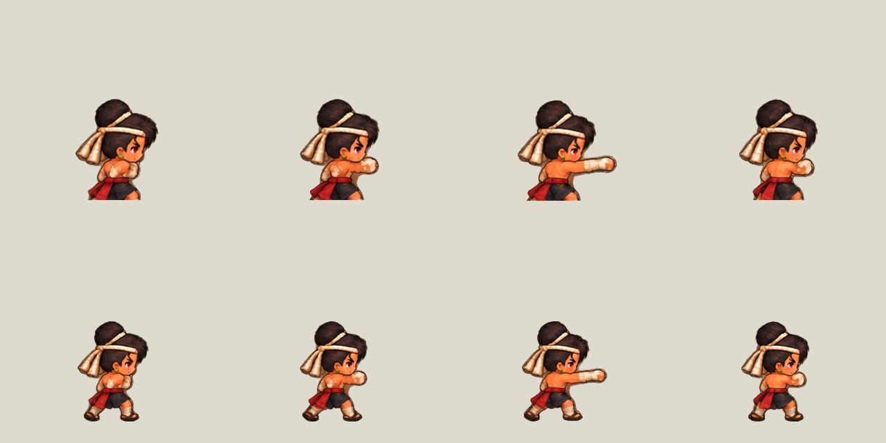

# Complete attack silhouettes — 228

The 224 packer cropped the generated master into five equal-height row strips before finding the character. Actual row placement varies. In the boxer east view the old strip ended at y=485 while the original legs continued past y=500. The cropped shorts were then treated as the sole for scale/ground calibration, producing an enlarged head and missing legs in game.

Extraction now operates on the full source alpha. Solid core seeds avoid tiny loose marks; complete connected silhouettes preserve limbs and weapon extents. A widest-path watershed separates thin accidental connections between neighbouring figures instead of introducing a horizontal body cut. Ground and body scale use the restored full figure.

The new assets are under assets/attack228. The previously published assets/attack224 and all retained archives stay unchanged. painted-attack224.js now validates and loads the corrected pack. Combat timings, stats, skills, loot and input are unchanged.

Regression: tests/attack_sheet228_test.py covers irregular row positions, touching figures, safe alpha margins for all 1,536 packed frames, and the restored source pixels below the former boxer row cutoff. Node renderer tests continue to cover all sixteen identities, views and HD/SD files. Local normal-motion evidence and browser results are in outputs/attack228-qa.

Build the pack with python scripts/build-attack224.py. Requires Pillow and NumPy; no runtime/server dependency was added. Publish as a fresh frozen frontend release through frontend-live only, following docs/releases223.md.

Validation: three Python tests passed, including alpha bounds for all 1,536 packed frames. Seventeen renderer/gait tests and ten skill/lighting tests passed. Real game.html completed 96 authoritative casts across sixteen identities in HD and SD, with zero browser errors and zero missing assets. A zoomed normal-motion boxer recording confirms all three poses include the legs and feet. Evidence is under outputs/attack228-qa; the three close-up contact screenshots are in its closeup directory.
