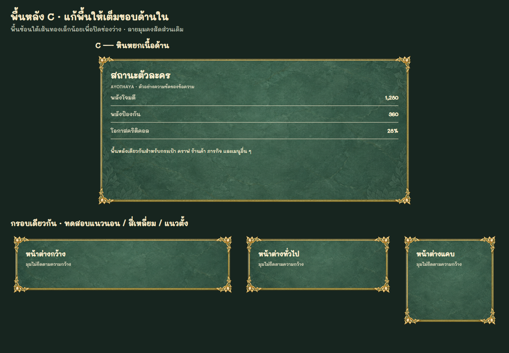

# มาตรฐานหน้าต่างเมนูถาวร — Unified Menu 236

เจ้าของเกมอนุมัติวันที่ 1 พฤศจิกายน 2026: ใช้กรอบทองชุดใหม่กับพื้นหลัง C (หินหยกเนื้อด้าน) ตามภาพที่แก้พื้นให้เต็มกรอบแล้ว เป็นมาตรฐานของเมนูปัจจุบันและเมนูที่จะเพิ่มในอนาคต จนกว่าเจ้าของจะสั่งเปลี่ยนโดยตรง

**สถานะ:** เชื่อมระบบหน้าต่างกลางเข้ากับเกมแล้ว ตรวจสกินของ dialog ที่เกมสร้าง 40 รายการ (รวม settings-panel เดิมที่ปิดใช้งานอยู่) และตรวจเมนูอื่นที่ไม่ใช่ dialog แยกต่างหาก กำลังจัดส่งใน release r236a-20261101-unified-menu; สถานะ production ต้องตรวจจาก release.json ของเว็บจริง

## ภาพอ้างอิงที่ต้องเปิดดูก่อนทำ UI

[ภาพพรีวิวขนาดมือถือ](images/unified-menu236/approved-phone.png)

ใช้ภาพที่แก้ช่องว่างแล้วนี้เป็นเกณฑ์ ห้ามใช้งานภาพ comparison รุ่นแรกที่พื้นยังไม่เต็มซ้าย–ขวา

## ไฟล์มาตรฐาน

- กรอบโปร่งใส: `assets/ui-unified236/frame.png` — 1254 × 1254 px
- พื้นหลังเดียวที่อนุมัติ: `assets/ui-unified236/matte-jade.png`
- พรอมป์ต์ ImageGen และ SHA-256: `assets/ui-unified236/provenance.json`
- ใช้ไฟล์เหล่านี้ร่วมกัน ไม่เจนกรอบใหม่แยกตามเมนู ไม่ใช้สี A/B และไม่ใส่พื้นผิวเก่ากลับมา

## ขอบเขตและข้อยกเว้น

ใช้กับหน้าต่างกระเป๋า สถานะ อุปกรณ์ สกิล เควส คราฟ ตีบวก ถอด/ใส่การ์ด ร้านค้า ตลาด ประมูล จดหมาย สังคม อันดับ ตั้งค่า บทสนทนา NPC และหน้าต่างเมนูใหม่ในอนาคต

- **กาชาและสัตว์เลี้ยง:** คงกรอบ ฉาก และรูปแบบที่เจ้าของอนุมัติเดิม รวมถึงหน้าต่างย่อยของสองระบบนี้ อย่าให้ตัวเลือก CSS ส่วนกลางไปเปลี่ยนโดยไม่ตั้งใจ
- **Tooltip ไอเท็มและหลอดดาเมจบอส:** คงกล่องข้อความเรียบตามข้อยกเว้นเดิม ไม่เพิ่มกรอบตกแต่ง
- ภาพแผนที่ ตัวละคร ไอเท็ม คัตซีน ฉากเนื้อเรื่อง และภาพชัยชนะไม่ใช่พื้นหลังเมนูที่จะลบ
- ร้านค้าที่อยู่ในโค้ด premium ร่วมกับกาชายังคงต้องย้ายมาใช้ธีมใหม่นี้ แยกตามหน้าจอ ไม่ยกเว้นทั้งโมดูล

## กฎสัดส่วนและการประกอบ

1. แยกพื้นหลังกับกรอบคนละชั้น ใช้ตัวเรนเดอร์/สไตล์กลางเดียวกัน
2. ใช้ nine-slice ล็อกสัดส่วนของลายมุมทั้งสี่ ยืดได้เฉพาะขอบตรง ห้ามยืดภาพกรอบทั้งภาพให้ตรงกับความกว้างและความสูงหน้าต่าง
3. ค่าอ้างอิงที่ตรวจภาพแล้ว: border-image-slice 28%; ความกว้างชิ้นกรอบ 60px เท่ากันทุกด้าน
4. สำหรับชิ้นกรอบ 60px พื้นหลังต้องเว้นบน–ล่าง 19.8px และซ้าย–ขวา 16.4px เพื่อซ้อนใต้เส้นทองและปิดช่องว่าง ห้ามใช้ inset 22px เท่ากันทุกด้านแบบเดิม
5. ถ้าปรับขนาดชิ้นกรอบ ให้คูณระยะพื้นหลังด้วยอัตราเดียวกัน: แนวตั้ง = ขนาดกรอบ × 0.33; แนวนอน = ขนาดกรอบ × 0.2733333333 แล้วตรวจภาพจริงทุก breakpoint
6. เส้นกรอบต้นฉบับที่กึ่งกลางภาพ: ซ้าย x=81..109; ขวา x=1145..1173; บน y=104..132; ล่าง y=1121..1151 ค่านี้เป็นหลักฐานการวัด ไม่ใช่ให้ตัดกรอบทิ้ง
7. พื้นใช้ center / cover / no-repeat และมุมโค้ง 8px ที่ขนาดอ้างอิง ต้องเต็มถึงเส้นกรอบด้านใน ไม่ล้นออกนอกขอบหรืออุดช่องโปร่งใสของลายมุม
8. รักษาระยะข้อความจากกรอบ สีตัวหนังสือครีม และลำดับหัวข้อให้สม่ำเสมอ ใช้ปุ่มภาพที่มีอยู่ตามกฎปุ่มเดิม ไม่เพิ่มแผ่นสี่เหลี่ยมแข็งหรือกรอบตกแต่งซ้อนโดยไม่มีหน้าที่
9. ห้ามใช้ overflow:hidden กับหน้าต่างทั้งอันเพื่อซ่อนปัญหาพื้นล้นจนตัดลายมุมหรือวง focus ให้เลื่อนเฉพาะส่วนเนื้อหาที่ต้องเลื่อน

## ก่อนส่งงานทุกครั้ง

- เปิดภาพมาตรฐานและใช้ไฟล์กลาง ตรวจคอม มือถือแนวตั้ง/แนวนอน หน้าต่างกว้าง/แคบ หลังภาพและฟอนต์โหลดครบ
- ตรวจทั้งสี่ขอบและมุม: พื้นเต็ม ไม่มีช่องมืด ไม่มีภาพล้น ลายมุมไม่แบน/ยืด ข้อความไม่ชิดกรอบ
- ตรวจข้อความไทยยาว การเลื่อน ปุ่มปิด โฟกัส และสถานะว่าง/กำลังโหลด/ผิดพลาด
- ยืนยันว่ากาชา สัตว์เลี้ยง tooltip และหลอดบอสยังคงข้อยกเว้น
- ตรวจด้วยตาจาก screenshot จริง การผ่าน overflow test อย่างเดียวไม่พอ
- งานธีมไม่เปลี่ยนราคา เรทสุ่ม รางวัล สเตตัส หรือกฎเซิร์ฟเวอร์

## การย้ายออกจากธีมเก่า

กฎนี้มีลำดับเหนือทางเลือกกรอบ/พื้นหลังเก่าใน ui-surfaces222 และเอกสารอื่นสำหรับเมนูที่อยู่ในขอบเขต ให้นำการอ้างอิงสกินเก่าออกเมื่อย้ายเมนูนั้นสำเร็จ แต่รักษาไฟล์ที่ archived releases หรือหน้ากาชา/สัตว์เลี้ยงยังใช้ เพื่อไม่ทำให้ผู้เล่นที่ยังไม่กดอัปเดตภาพหาย ห้ามแก้ archive ย้อนหลัง

## ตัวเรนเดอร์กลางและการเพิ่มเมนู

- `unified-menu236.js` + `unified-menu236.css` เป็นเจ้าของกรอบ พื้นหลัง ระยะขอบ และปุ่มปิด ส่วน `jade-surfaces222.js` เป็นทางเข้า compatibility สำหรับเกมและ lab เดิม
- dialog ใหม่และ `[data-hud-panel]` / `[role="dialog"]` ใช้มาตรฐานโดยอัตโนมัติ รวมการสร้างทีหลังและการแทน innerHTML อย่าประกอบกรอบซ้ำในโมดูลเมนู
- เมนู div ที่มีอยู่ (ตั้งค่า แชท เมนูรวม มือถือ ป๊อปอัปช่อง และผู้เล่น) ลงทะเบียนไว้ใน MENU_CANDIDATES236 แล้ว
- ตั้งค่าต้องใส่สกินที่ `.account-card` ไม่ใช่ `#account-panel` ซึ่งเป็นฉากบังหลัง การเลื่อนอยู่ใน `.settings-grid` เพื่อคงหัวข้อและปุ่มปิด
- ชั้น `.menu-skin236` เป็น decoration: inert, aria-hidden, pointer-events:none; ห้ามใส่ปุ่มหรือข้อมูลลงในชั้นนี้
- เมนูแบบ scroll ที่ยังใช้โครงสร้างเดิมมี passive scroll listener ตรึงภาพกรอบ ไม่สแกนทั้ง DOM ใน game loop
- `data-menu-theme="preserve"` สงวนสำหรับข้อยกเว้นที่เจ้าของอนุมัติเท่านั้น ไม่ใช้เลี่ยงมาตรฐานกับเมนูใหม่
- CSS ของโมดูลเก่าที่ใช้ร่วมกับหน้าข้อยกเว้น/รุ่นเก่ายังเก็บไว้ แต่สกินส่วนกลางล้างภาพกรอบ root และ pseudo-element ของเมนูปัจจุบัน ไม่ลบ asset ที่ release เก่ายังอ้างอิง

## หลักฐานการตรวจ 1 พฤศจิกายน 2026

- รันเกมกับเซิร์ฟเวอร์ท้องถิ่นและบัญชีทดสอบ เปิดจริง 15 ทางเข้าบนเมนูหลัก รวมกระเป๋า สถานะ สกิล เควส ตลาด อันดับ สังคม ตั้งค่า จดหมาย MVP ร้านค้า ประลอง กาชา สัตว์เลี้ยง และเมนูเพิ่ม; เปิดคราฟจากกระเป๋าเพิ่มด้วย ไม่มี pageerror
- ตรวจภาพจริงกระเป๋า สกิล เควส ร้านค้า และตั้งค่าขนาด 844×390 จากเกมที่กำลังรัน
- ตรวจ DOM/CSS ของหน้าต่างเกม 40 รายการที่ 1440×900, 844×390 และ 390×844; เป็นการตรวจสกิน ไม่ใช่การทำธุรกรรม/เควสจริงครบทุกเมนู
- `node scripts/check-unified-menu236.mjs`: 1440×900, 844×390, 390×844 และ 320×568; ตรวจ CSS เก่าโหลดทีหลัง, dialog ใหม่, การแทนเนื้อหา, ไม่มีกรอบซ้ำ, การเลื่อน, ปุ่มปิด และข้อยกเว้น
- `node scripts/check-ui-surfaces222.mjs` ส่งต่อไป checker ใหม่เพื่อไม่ให้ตรวจยืนยันแบบเก่า
- ภาพและรายงานเต็มอยู่ที่ `outputs/menu-migration236/` (local evidence ไม่เผยแพร่ข้อมูล fixture)
- ผลตรวจจาก headless browser และบัญชีทดสอบ ไม่ใช่หลักฐานทดสอบบนมือถือจริงหรือการเผยแพร่ production
